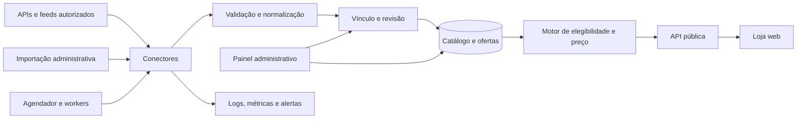

# PRD — Tako Store

**Versão:** 0.2  
**Data:** 27 de outubro de 2026  
**Produto:** loja web de jogos e comparador de preços do ecossistema Tako  
**Status:** proposta consolidada para orientar o desenvolvimento  
**Mercado inicial:** Brasil  
**Idioma inicial:** português brasileiro  
**Moeda inicial:** real brasileiro — BRL

## 1. Resumo

A **Tako Store** será uma loja web para descoberta de jogos e comparação de preços. Sua experiência visual e de navegação terá como referência lojas como Steam e Epic Games Store: uma home com destaques, páginas de jogos, categorias, busca e promoções.

A Tako Store reunirá ofertas de diferentes lojas, incluindo parceiras e lojas com as quais ainda não exista parceria. O usuário poderá comparar as opções e seguir para o site escolhido, onde concluirá a compra.

A receita prevista virá de **links de afiliado**, quando existir parceria e o programa permitir. A Tako Store não terá checkout próprio na primeira versão.

O produto terá um painel administrativo completo para gerenciar jogos, vínculos, ofertas, lojas, integrações e toda a apresentação da home.

### Proposta de valor

> Encontrar jogos e comparar ofertas válidas para o Brasil em uma experiência de loja que faz parte do ecossistema Tako.

### Princípio central

A loja deve apresentar o **menor preço elegível entre as ofertas acompanhadas**, considerando produto, edição, região, moeda, disponibilidade e validade da informação.

A posição de uma oferta na comparação por preço não deve depender de a loja possuir parceria com a Tako.

## 2. Contexto do ecossistema Tako

O PRD do Tako Launcher descreve um launcher de jogos para Windows, Linux e macOS, focado em biblioteca unificada, controle e experiência em telas grandes. O aplicativo é planejado para continuar funcionando offline.

A Tako Store será um produto complementar:

| Tako Launcher | Tako Store |
|---|---|
| Organiza a biblioteca do usuário. | Apresenta um catálogo público de jogos. |
| Abre jogos já disponíveis no dispositivo. | Ajuda o usuário a encontrar e comparar ofertas. |
| Deve funcionar offline. | Depende de serviços online para catálogo e preços. |
| Usa uma experiência voltada a controle e TV. | Prioriza navegação web responsiva e mantém acessibilidade por teclado. |
| Pode integrar lojas e fontes de biblioteca. | Integra fontes de metadados, produtos e preços. |

A indisponibilidade da Tako Store não poderá impedir o funcionamento do launcher.

### Elementos que devem ser aproveitados

- A identidade visual e os princípios do design system atual (`DESIGN.md` no repositório do launcher).
- As regras de busca, identificação e deduplicação de jogos já estudadas no launcher.
- O conhecimento existente sobre metadados e identificadores de fontes externas.
- O fluxo Git Flow descrito no guia de contribuição (`CONTRIBUTING.md`).
- A preocupação com acessibilidade, navegação por foco e uso em telas grandes.

O PRD do launcher prevê Rust e Slint para o aplicativo. Essa decisão não determina automaticamente a stack da loja web, que tem requisitos diferentes de publicação, busca, indexação, administração e ingestão de dados.

## 3. Objetivos

### 3.1 Objetivos do produto

1. Permitir que usuários descubram jogos e promoções.
2. Apresentar preços de várias lojas em um só lugar.
3. Destacar a menor oferta elegível disponível entre as fontes acompanhadas.
4. Dar transparência sobre loja, edição, região, plataforma de ativação e atualização do preço.
5. Encaminhar o usuário para comprar no site da loja escolhida.
6. Permitir monetização por links de afiliado quando houver parceria.
7. Oferecer uma experiência visual consistente com o Tako Launcher.
8. Preparar uma futura integração entre loja e launcher.

### 3.2 Objetivos operacionais

1. Permitir que a equipe gerencie catálogo e home sem alterações de código.
2. Oferecer uma fila de revisão para vínculos ambíguos entre produtos de lojas e jogos.
3. Adicionar novas fontes de preços sem reescrever o sistema inteiro.
4. Identificar dados vencidos, falhas de importação e erros de vínculo.
5. Permitir a operação inicial mesmo enquanto os acordos com parceiros são buscados.

### 3.3 Objetivo para o desenvolvimento

O projeto deve ser dividido em entregas pequenas e independentes, adequadas ao trabalho contínuo com agentes de código e ao fluxo de issues e pull requests no GitHub.

O máximo possível da plataforma deve poder ser construído e testado com **dados fictícios e fontes de demonstração**, sem depender antecipadamente de credenciais de parceiros.

## 4. Decisões já tomadas

| Tema | Decisão |
|---|---|
| Mercado inicial | Brasil. |
| Idioma inicial | Português brasileiro. |
| Moeda inicial | BRL. |
| Tipo de produto | Loja de descoberta e comparador de preços de jogos. |
| Lojas exibidas | Lojas parceiras e lojas com as quais ainda não exista parceria, desde que haja uma fonte autorizada e confiável para os dados. |
| Compra | Sempre concluída no site da loja indicada. |
| Receita | Links de afiliado, quando houver parceria e o programa permitir. |
| Checkout próprio | Fora da primeira versão. |
| Painel administrativo | Obrigatório e completo. |
| Design | Adaptar o design system existente do Tako para web. |
| Repositório | Inicialmente público para aproveitar o GitHub Actions; intenção de torná-lo privado posteriormente. |
| Fluxo Git | Git Flow com `main`, `develop`, branches de feature, release e hotfix. |
| Acesso a parceiros | Ainda não existem acessos ou acordos; serão buscados durante o desenvolvimento. |
| Projeto | Novo projeto para a loja, independente do repositório do launcher. |

### Decisões ainda abertas

- Licença do novo repositório.
- Stack web e infraestrutura definitivas.
- Domínio e hospedagem.
- Primeiras lojas com integração real.
- Forma de obtenção dos dados de cada loja.
- Provedor inicial de metadados e imagens.
- Prazo de atualização aceitável para cada fonte.
- Necessidade e formato de uma conta pública de usuário.
- Identidade definitiva do produto: “Tako Store” é o nome de trabalho deste PRD.

Essas decisões não impedem a construção inicial com interfaces bem definidas e dados de demonstração.

## 5. Público e jornadas principais

### 5.1 Jogador que procura um título

1. Entra na loja.
2. Pesquisa pelo nome do jogo.
3. Abre a página do título.
4. Escolhe a edição e verifica a plataforma de ativação.
5. Compara as ofertas válidas para o Brasil.
6. Abre a oferta desejada.
7. Conclui a compra no site da loja indicada.

### 5.2 Jogador que quer descobrir promoções

1. Acessa a home.
2. Navega por destaques, gêneros ou promoções.
3. Filtra por preço, loja ou plataforma.
4. Abre um jogo.
5. Compara as ofertas e visita uma loja.

### 5.3 Editor do catálogo

1. Recebe jogos e produtos importados de fontes externas.
2. Revisa os vínculos sugeridos.
3. Corrige edição, plataforma ou informações do jogo quando necessário.
4. Publica os produtos que estão prontos.
5. Acompanha problemas de dados e ofertas.

### 5.4 Editor da home

1. Cria ou edita uma seção.
2. Seleciona jogos ou configura uma regra automática.
3. Organiza a ordem e o período de publicação.
4. Visualiza o resultado.
5. Publica sem necessidade de alteração de código.

### 5.5 Operador de integrações

1. Cadastra uma loja e sua fonte de dados.
2. Documenta as condições de acesso e uso.
3. Configura a integração autorizada.
4. Acompanha importações e erros.
5. Pausa ou corrige a fonte quando necessário.

## 6. Escopo da primeira versão

### Incluído

- Home configurável.
- Busca de jogos.
- Catálogo com filtros e ordenação.
- Páginas individuais de jogos.
- Comparação de ofertas por edição, região e plataforma.
- Destaque para o menor preço elegível.
- Redirecionamento para lojas externas.
- Links de afiliado quando disponíveis e permitidos.
- Exibição de lojas sem parceria.
- Painel administrativo.
- Cadastro e revisão de jogos e produtos.
- Gestão de vínculos entre produtos externos e catálogo interno.
- Importação de ofertas.
- Arquitetura para conectores de parceiros e outras fontes autorizadas.
- Monitoramento básico das integrações.
- Design responsivo.
- Acessibilidade por teclado.
- Estrutura para SEO.
- Ambientes de desenvolvimento, homologação e produção.

### Fora da primeira versão

- Checkout ou pagamentos dentro da Tako.
- Venda e entrega direta de chaves.
- Carteira, saldo ou créditos da Tako.
- Marketplace aberto para qualquer vendedor.
- Aplicativos móveis nativos.
- Avaliações e comentários de usuários.
- Rede social ou fóruns.
- Recomendações com inteligência artificial.
- Sincronização de conta e biblioteca com o launcher.
- Extensão de navegador.
- Histórico de preços completo de períodos anteriores ao início da coleta.
- Integração obrigatória com todas as lojas desejadas.

### Funcionalidades posteriores

- Lista de desejos.
- Alertas de queda de preço.
- Histórico de preços.
- Contas de usuário.
- Sincronização entre dispositivos.
- Integração com o Tako Launcher.
- Páginas de franquias, desenvolvedoras e distribuidoras.
- Descoberta de jogos gratuitos.
- Recomendações personalizadas.
- Comparação de preços em outras regiões e moedas.

## 7. Catálogo e dados de jogos

### 7.1 Modelo de catálogo

O catálogo deve distinguir:

- **Jogo:** identidade principal do título.
- **Produto:** item que pode ser comparado e adquirido.
- **Edição:** Standard, Deluxe, Ultimate ou equivalente.
- **DLC:** conteúdo adicional que pode exigir o jogo base.
- **Bundle:** conjunto de produtos vendido como uma oferta.
- **Plataforma de ativação:** Steam, Epic Games Store, GOG, Xbox ou outra informada.
- **Sistema operacional:** Windows, Linux ou macOS, quando houver dados confiáveis.
- **Loja:** estabelecimento ou site que apresenta a oferta.
- **Fonte de dados:** API, feed, arquivo ou outra origem autorizada que fornece a informação.

Uma loja que vende uma chave Steam e a Steam como plataforma de ativação são entidades diferentes.

### 7.2 Informações de um jogo

Sempre que disponíveis e permitidas:

- Título principal e títulos alternativos.
- Descrição e data de lançamento.
- Desenvolvedora e distribuidora.
- Gêneros e categorias.
- Capa, imagem de fundo, logo e capturas de tela.
- Trailer ou vídeo.
- Plataformas de ativação e sistemas operacionais.
- Requisitos de sistema.
- Identificadores externos.
- Classificação indicativa, quando houver fonte confiável.
- Edições e produtos relacionados.

Campos não disponíveis devem aparecer como ausentes. O sistema não deve preencher requisitos, compatibilidade ou classificação com suposições.

### 7.3 Fontes de metadados e imagens

O launcher já considera provedores como Steam Store, IGDB, ScreenScraper e SteamGridDB. Eles podem ser avaliados para o site, mas o uso no launcher não prova que o mesmo conteúdo pode ser usado em uma loja web.

Cada provedor escolhido deve ter documentação sobre tipo de conteúdo, permissão para uso no site, atribuição, restrições de cache e redistribuição, limites, autenticação e cobertura.

## 8. Lojas, parceiros e links

### 8.1 Lojas desejadas para investigação

- Nuuvem.
- Green Man Gaming.
- Instant Gaming.
- Outras lojas relevantes para o público brasileiro e com dados utilizáveis.

Nenhuma dessas integrações deve ser considerada pronta até que existam acesso, documentação e validação dos dados.

### 8.2 Estados de parceria

| Estado | Significado |
|---|---|
| **Parceira ativa** | Existe parceria e a configuração necessária está válida. |
| **Parceria pendente** | A equipe iniciou ou pretende iniciar o processo de parceria. |
| **Sem parceria** | A loja pode ser exibida, mas não possui parceria ativa com a Tako. |
| **Desativada** | A loja e suas ofertas não devem aparecer publicamente. |

O estado da parceria é administrativo e não define a ordem de comparação de preços.

### 8.3 Tipos de link

1. **Link de afiliado próprio**, quando a Tako tiver parceria e o programa permitir.
2. **Link fornecido pela fonte**, quando a fonte exigir que ele seja preservado.
3. **Link direto para a loja**, quando não houver parceria e o uso do link for permitido.

O sistema deve manter as regras específicas de cada fonte. Não deve remover ou substituir parâmetros obrigatórios.

### 8.4 Transparência

- O usuário deve saber qual loja está oferecendo o produto.
- A página deve informar que a compra é concluída em um site externo.
- A identificação de links de afiliado deve seguir as regras aplicáveis e ser configurável por fonte.
- A comissão não deve alterar a indicação do menor preço.

## 9. Pesquisa de fontes de preços

A arquitetura deve permitir combinar diferentes tipos de fonte, mas uma integração só poderá entrar em produção depois de validada.

| Fonte | Situação identificada | Próxima ação |
|---|---|---|
| **Steam** | API pública da vitrine, sem chave, em BRL. Já conectada e responsável pelo catálogo real. | Confirmar os termos de uso comercial antes do lançamento público (OPS-003). |
| **Nuuvem** | Possui API oficial documentada (v3, token Bearer, preços em BRL, `steam_app_id` no payload), em beta e restrita a parceiros selecionados. | Pedir acesso ao suporte da Nuuvem; aprovado, conectar como conector oficial. |
| **Green Man Gaming** | O programa Business Affiliate expõe API de catálogo (7.000+ jogos), direto ou via Admitad. | Buscar aprovação no programa e validar cobertura em BRL, frequência e regras de link. |
| **Gamivo** | Envia feed XML para comparadores de preço sob pedido (`affiliate@gamivo.com`), após aprovação no programa de afiliados. | Buscar aprovação e cadastrar o feed em `/admin/fontes`. |
| **Eneba** | Entrega feed XML/CSV após aprovação no programa de afiliados; a API GraphQL é restrita a merchants. | Buscar aprovação no programa de afiliados e validar o feed. |
| **Fanatical** | Possui MCP oficial público, sem autenticação, testado ao vivo; para a região BR devolve preços em USD. | Sem BRL não entra na comparação do Brasil; reavaliar se passar a servir real. |
| **Instant Gaming** | Sem API oficial; só raspagem de terceiros, que fica de fora (regra deste PRD). O caminho planejado é o coletor de anunciantes (PAR-005). | Escolher os canais de anunciantes quando PAR-005 entrar. |
| **CDKeys** | Sem API oficial; só raspagem de terceiros, que fica de fora (regra deste PRD). O caminho planejado é o coletor de anunciantes (PAR-005). | Escolher os canais de anunciantes quando PAR-005 entrar. |
| **IsThereAnyDeal** | Possui API de preços, mas seus termos restringem aplicações que possam ser consideradas concorrentes e proíbem alterar dados e tags de afiliado. | Não usar como base da Tako Store sem autorização explícita. [Documentação e termos](https://docs.isthereanydeal.com/) |
| **GG.deals** | Possui API e informa condições próprias para uso comercial, atribuição e preservação de links. | Avaliar cobertura brasileira, custos, condições e compatibilidade. [API e termos](https://gg.deals/api/) |
| **CheapShark** | Possui API de jogos e ofertas e utiliza redirecionamento próprio em sua documentação. | Validar cobertura em BRL, parceiros, termos e links antes de usar. [Documentação oficial](https://www.postman.com/cheapshark/cheapshark-s-public-workspace/documentation/7h22uhl/cheapshark-api) |
| **Projetos open source** | Existem clientes de APIs de ofertas, como o [Game-Deal](https://github.com/criticalsession/game-deal). | Avaliar como referência técnica, conferindo licença e manutenção. Código aberto não garante acesso autorizado aos dados. |

O mapa técnico completo de cada loja (o que fornece, moeda e o que destrava) está em `docs/integracoes.md` §6.

### Ordem de preferência para obtenção de dados

1. API oficial autorizada.
2. Feed oficial do parceiro ou da rede de afiliados.
3. Exportação estruturada autorizada.
4. Integração desenvolvida sob acordo específico.
5. Coleta de páginas, somente após verificar permissão e viabilidade para aquela fonte.

### Coletor de anunciantes para lojas sem API (Telegram e similares)

Para lojas sem caminho oficial — Instant Gaming e CDKeys, hoje — a coleta não raspa a loja: acompanha os
próprios anunciantes (vendedores que publicam as ofertas deles, por exemplo em canais de Telegram) e converte
o anúncio em oferta estruturada. O coletor, além de puxar, adapta o link ao modelo de afiliado cadastrado e
alimenta a loja como qualquer outra fonte.

Regras do coletor, todas obrigatórias:

1. Só entra oferta com dado real do anúncio: jogo, preço em BRL e link do anunciante. Sem dado, a oferta não é publicada — nada é inventado para preencher.
2. O link do anúncio só é adaptado pelo template de afiliado cadastrado daquela loja (com `{url}` e domínio na lista permitida). Domínio fora da lista não é publicado.
3. A compra acontece na loja do anunciante; a Tako Store encaminha, com atribuição visível da fonte.
4. Vale a mesma régua das outras fontes: preço inteiro em centavos, região, validade, disponibilidade e expiração. O estado da parceria não muda a ordem do menor preço.
5. Cada canal ou anunciante é cadastrado como fonte (PAR-004), com cadência própria, e pode ser pausado no painel; falha de leitura fica no relatório da execução, com código e linha.

É tarefa difícil de propósito: anúncio é texto livre, chega duplicado, é editado e removido sem aviso — exige
deduplicação, tolerância a variação e vigilância de validade maiores que uma API. Fica fora da primeira versão
e entra por decisão do responsável, com os canais escolhidos (backlog PAR-005).

Uma extensão de navegador pode ser estudada no futuro, mas não é necessária para que a loja funcione.

## 10. Regras de comparação de preços

### 10.1 Menor preço elegível

A menor oferta é a de menor valor entre as ofertas que:

- Correspondem ao mesmo produto e edição.
- São válidas para o Brasil.
- Estão em BRL.
- Estão disponíveis.
- Pertencem a uma loja e fonte habilitadas.
- Possuem atualização dentro do prazo configurado.
- Atendem à plataforma de ativação selecionada.
- Informam as condições necessárias para alcançar o preço apresentado.

A interface deve usar uma expressão como **“menor preço entre as ofertas acompanhadas”**. O produto não deve prometer o menor preço de toda a internet.

### 10.2 Produtos que não podem ser misturados

- Jogo base e DLC.
- Edição Standard e Deluxe.
- Jogo individual e bundle.
- Chave Steam e chave Xbox quando o usuário selecionou uma plataforma.
- Oferta válida no Brasil e oferta restrita a outra região.
- Oferta disponível e oferta esgotada.
- Preço público e preço condicionado a assinatura ou cupom, sem informar a condição.

### 10.3 Preços e moedas

- Armazenar preços como inteiros na menor unidade monetária.
- Armazenar moeda, país, preço atual, preço de referência e horários relevantes.
- Não usar ponto flutuante para valores monetários.
- Não comparar moedas diferentes automaticamente.
- Não converter um preço para BRL e apresentá-lo como oferta brasileira, a menos que essa capacidade seja planejada e identificada como estimativa.
- Exibir desconto apenas quando houver valores de referência confiáveis.
- Informar cupom ou assinatura quando o preço depender deles.
- Exibir taxas e custos adicionais apenas quando forem fornecidos de maneira confiável.

### 10.4 Dados vencidos

- Uma oferta vencida não deve disputar o selo de menor preço.
- Se nenhuma oferta estiver atualizada, a página deve informar que não há preço atualizado disponível.
- O último preço conhecido não deve ser apresentado como atual sem identificação.
- A falha de uma fonte não deve impedir a exibição das demais.

**Prazo inicial para desenvolvimento:** 24 horas, configurável por fonte. Antes do lançamento, esse valor deve ser ajustado à frequência real de cada integração.

### 10.5 Empates

- Ordenar por preço crescente.
- Em caso de empate, utilizar uma ordenação estável e documentada.
- Não favorecer automaticamente uma loja por possuir parceria.
- Se houver conteúdo patrocinado no futuro, identificá-lo e separá-lo da comparação por menor preço.

### 10.6 Histórico

O histórico deve registrar observações com origem e data. Uma oferta só pode ser chamada de “menor preço histórico” quando a tela informar o período e a cobertura considerados. A Tako não deve presumir conhecimento de preços anteriores ao início de sua coleta, salvo quando houver uma fonte autorizada para isso.

## 11. Loja pública

### 11.1 Home

A home deve transmitir uma experiência de loja de jogos e permitir descoberta visual.

Componentes: banner principal, jogos em destaque, promoções, novidades, categorias, gêneros, jogos selecionados pela equipe, seções automáticas por regras e busca acessível a partir de qualquer página.

A ordem e o conteúdo das seções são gerenciados pelo painel. Seções podem ser publicadas, ocultadas e agendadas. Jogos indisponíveis não quebram o layout; seções sem itens podem ser ocultadas. A home deve funcionar em dispositivos móveis, desktop e telas grandes.

### 11.2 Busca

- Pesquisar por título principal e títulos alternativos.
- Ignorar diferenças de maiúsculas e acentos e tratar espaços extras.
- Apresentar sugestões durante a digitação.
- Mostrar capa, título e preço elegível quando houver.
- Apresentar estado claro para nenhum resultado.
- Funcionar com teclado e leitor de tela.

### 11.3 Catálogo

**Filtros iniciais:** gênero, plataforma de ativação, sistema operacional quando disponível, faixa de preço, loja, promoção, disponibilidade para o Brasil e tipo de produto ou edição.

**Ordenações:** relevância, menor preço, maior desconto, nome e data de lançamento.

Os filtros devem ser representados na URL para permitir compartilhamento e navegação pelo histórico do navegador.

### 11.4 Página do jogo

A página deve apresentar, quando disponíveis: título; capa, fundo, logo e capturas; descrição; desenvolvedora e distribuidora; data de lançamento; gêneros; requisitos; plataformas de ativação; edições e produtos relacionados; lista de ofertas; menor preço elegível; loja e preço; região e plataforma de ativação; desconto e condições; data ou horário da última atualização; botão para visitar a oferta; e atribuições necessárias.

A página deve ter estados claros para nenhuma oferta encontrada, ofertas vencidas, produto indisponível, jogo sem imagens e erro temporário ao consultar dados.

### 11.5 Redirecionamento

- A URL deve estar associada a uma oferta conhecida e a um domínio permitido.
- O usuário não pode fornecer uma URL arbitrária ao endpoint de redirecionamento.
- Parâmetros obrigatórios da fonte devem ser preservados.
- O clique pode ser registrado com dados mínimos para operação e métricas.
- O usuário deve entender que a compra será feita em outra loja.

## 12. Painel administrativo

O painel é um produto interno permanente e deve permitir o gerenciamento da operação sem depender de alterações de código para tarefas comuns.

### 12.1 Perfis e permissões

| Perfil | Responsabilidades |
|---|---|
| **Administrador** | Gerencia usuários, permissões, configurações e todas as áreas. |
| **Editor de catálogo** | Gerencia jogos, produtos, imagens, metadados e vínculos. |
| **Editor de conteúdo** | Gerencia home, banners, seções e páginas editoriais. |
| **Operador de integrações** | Gerencia fontes, importações, erros e execução de conectores. |
| **Leitura** | Consulta informações sem alterar dados. |

Requisitos de acesso: autenticação segura; suporte a MFA para administradores; permissões verificadas no servidor; sessões revogáveis; registro de ações administrativas importantes; credenciais protegidas; segredos nunca exibidos novamente em texto puro após cadastrados.

### 12.2 Gestão de jogos

- Criar, editar, publicar, ocultar e arquivar jogos.
- Gerenciar títulos alternativos.
- Editar descrições, gêneros, datas e empresas.
- Gerenciar identificadores externos.
- Criar edições, DLCs e bundles.
- Gerenciar imagens e suas origens.
- Visualizar ofertas e problemas relacionados.
- Importar e exportar catálogo em formato documentado.
- Executar alterações em lote com prévia.
- Identificar e unir duplicatas com registro de auditoria.

### 12.3 Gestão de vínculos

O painel deve exibir lado a lado: produto recebido da fonte, nome original, identificador externo, edição, plataforma e região informadas, jogo e produto sugeridos pela Tako, motivo da sugestão, nível de confiança e histórico de decisões.

Ações: aprovar, rejeitar ou vincular manualmente; criar produto inexistente; desvincular produto; enviar para revisão posterior; corrigir vínculos em lote com prévia.

**Regra:** nomes semelhantes, sozinhos, não são suficientes para unir automaticamente produtos com edições ou plataformas ambíguas.

### 12.4 Gestão da home

- Criar e editar banners e seções.
- Selecionar jogos manualmente ou aplicar regras automáticas.
- Definir ordem e período de publicação.
- Salvar rascunho, pré-visualizar e publicar.
- Consultar histórico e restaurar versão anterior.

Exemplos de seções automáticas: jogos com desconto mínimo; ofertas abaixo de determinado preço; jogos de uma categoria; jogos adicionados recentemente; jogos de lojas selecionadas.

### 12.5 Gestão de lojas e parcerias

- Cadastrar lojas antes mesmo de existir uma integração.
- Registrar estado da parceria, contatos e documentação.
- Registrar região e moeda cobertas.
- Configurar domínios de destino permitidos e tipo de link.
- Registrar restrições de atribuição.
- Ativar ou desativar a loja e consultar histórico de alterações.

### 12.6 Gestão de integrações

- Cadastrar fontes e configurar credenciais por ambiente.
- Configurar frequência e validade.
- Executar importação manual, pausar e retomar fonte.
- Consultar execuções e quantidades recebidas, aceitas e rejeitadas.
- Ver erros por item e reprocessar falhas.
- Identificar preços vencidos e desativar ofertas de fonte problemática.
- Registrar limitações e regras da fonte.

### 12.7 Painel de qualidade

Destacar jogos publicados sem arte ou descrição, produtos sem vínculo, revisões pendentes, ofertas sem edição ou plataforma identificada, ofertas vencidas, preços inválidos, variações anormais, falhas consecutivas, links inválidos e conteúdo editorial prestes a expirar.

## 13. Arquitetura proposta

A arquitetura deve permitir que diferentes fontes forneçam dados em formatos próprios, sem levar esses formatos diretamente para a interface pública.



### Componentes

1. **Loja web:** home, busca, catálogo e páginas de jogos.
2. **Painel administrativo:** operação de catálogo, conteúdo e fontes.
3. **API:** acesso público e operações administrativas autorizadas.
4. **Banco relacional:** catálogo, produtos, ofertas, usuários administrativos e auditoria.
5. **Conectores:** integração individual com cada fonte.
6. **Workers:** importações e tarefas agendadas.
7. **Armazenamento de mídia:** imagens e arquivos autorizados.
8. **Busca:** inicialmente baseada no banco, com evolução posterior se necessário.
9. **Observabilidade:** logs, métricas, histórico de execução e alertas.

### Stack inicial recomendada

Esta é uma proposta para acelerar o desenvolvimento, sujeita a ADR:

| Responsabilidade | Proposta |
|---|---|
| Linguagem | TypeScript. |
| Interface | React com framework adequado a renderização no servidor e SEO. |
| Backend | TypeScript, com módulos separados por domínio. |
| Banco | PostgreSQL. |
| Tarefas | Workers e fila persistente. |
| Imagens | Armazenamento de objetos. |
| Testes | Unidade, integração e navegador. |
| Ambiente local | Contêineres e configuração documentada. |

A escolha final do framework, serviços e infraestrutura deve ser documentada no novo repositório.

### Estrutura sugerida

```text
apps/
  web/                 # loja pública
  admin/               # painel administrativo
  worker/              # importações e tarefas
packages/
  domain/              # regras de catálogo e ofertas
  connectors/          # contratos e conectores por fonte
  ui/                  # componentes web do Tako
  design-tokens/       # tokens adaptados do launcher
  config/              # configuração compartilhada
docs/
  prd/
  adr/
  integrations/
  operations/
```

É possível começar com menos aplicações implantáveis, desde que as fronteiras entre responsabilidades sejam mantidas.

## 14. Modelo de dados conceitual

| Entidade | Responsabilidade |
|---|---|
| `Game` | Identidade principal e metadados do jogo. |
| `Product` | Produto comparável: jogo base, edição, DLC ou bundle. |
| `ProductRelation` | Relação entre produtos. |
| `ExternalIdentifier` | Identificadores em fontes externas. |
| `Store` | Loja apresentada ao usuário. |
| `PartnerStatus` | Situação da parceria com a loja. |
| `Source` | Origem técnica dos dados. |
| `ExternalProduct` | Produto como recebido da fonte. |
| `ProductMapping` | Vínculo entre produto externo e produto canônico. |
| `Offer` | Oferta atual por produto, loja, região e plataforma. |
| `PriceObservation` | Registro de preço e horário para histórico. |
| `IngestionRun` | Execução de importação e seus resultados. |
| `MediaAsset` | Imagem, origem e condições de uso. |
| `HomeSection` | Seção configurável da home. |
| `HomeItem` | Item ou jogo de uma seção. |
| `AdminUser` | Usuário administrativo. |
| `Role` | Permissões administrativas. |
| `AuditEvent` | Registro de alterações relevantes. |

### Integridade

- Identificadores externos devem ser únicos dentro da fonte.
- A mesma importação deve poder ser executada novamente sem criar duplicatas.
- Uma observação antiga não deve substituir uma oferta mais recente.
- Um vínculo confirmado manualmente não deve ser sobrescrito silenciosamente.
- A origem dos dados deve ser preservada.
- Histórico e auditoria devem sobreviver à desativação de produtos e lojas.
- Valores monetários devem usar representação inteira.

## 15. Pipeline de importação

### Etapas

1. **Coleta:** receber dados da fonte autorizada.
2. **Validação:** verificar formato, preço, moeda, região e URL.
3. **Normalização:** converter para o modelo interno sem perder a origem.
4. **Identificação:** localizar o produto canônico por IDs e regras de correspondência.
5. **Revisão:** enviar ambiguidades para o painel.
6. **Persistência:** atualizar ofertas de forma idempotente.
7. **Recalcular:** atualizar resultados de busca e menor preço.
8. **Monitorar:** registrar resultados, erros e duração.

### Contrato mínimo de cada conector

Nome e versão; tipo de acesso; países e moedas suportados; limites e frequência; campos disponíveis; formato dos identificadores; regras para links e atribuição; tratamento de esgotamento; tratamento de erros e limites de requisição; exemplos fictícios; testes de respostas válidas e inválidas; documentação operacional.

### Resiliência

- Limitar concorrência por fonte e respeitar limites de requisições.
- Usar novas tentativas com intervalo crescente.
- Evitar execuções concorrentes duplicadas do mesmo lote.
- Separar erros temporários de dados inválidos.
- Permitir reprocessamento seguro.
- Alertar sobre falhas consecutivas.
- Não bloquear outras integrações quando uma fonte falhar.

## 16. Design system

A loja deve adaptar o design system do Tako Launcher para a web.

### Elementos a preservar

- Fundo escuro `#0E1116`.
- Acento vermelho `#C8102E`.
- Cor de fallback `#2B3A55`.
- Superfícies translúcidas e arte dos jogos como elemento visual.
- **Source Sans 3** para títulos e **Inter** para textos e interface.
- Cantos arredondados e botões em formato de pílula.
- Foco evidente e animações coerentes com o launcher.

### Adaptações para web

- Escala tipográfica apropriada para celular e desktop.
- Grades e breakpoints responsivos.
- Componentes para preço, desconto, loja e condições.
- Tabelas e formulários para o painel.
- Estados de carregamento, erro, vazio e indisponibilidade.
- Foco por teclado e preferência por movimento reduzido.
- Contraste adequado sobre imagens.
- Uso de cor dinâmica apenas quando preservar a legibilidade.

### Componentes iniciais

Botões; campos e busca; cards de jogos; cards e linhas de oferta; selos de desconto; seletor de edição; filtros; trilhos de jogos; banner principal; navegação; modal e confirmação; tabela administrativa; alertas e estados vazios.

## 17. Requisitos não funcionais

### 17.1 Acessibilidade

- Navegação principal por teclado e foco visível.
- Rótulos adequados e mensagens de erro compreensíveis.
- Suporte a leitores de tela e texto alternativo para imagens informativas.
- Respeito à preferência por movimento reduzido.
- Meta inicial de WCAG 2.2 AA, a verificar antes do lançamento.

### 17.2 Desempenho

Metas iniciais para orientar implementação e medição:

- Imagens otimizadas e carregamento progressivo.
- Busca e filtros responsivos.
- Importações sem degradar a navegação pública.
- LCP de até 2,5 segundos.
- INP de até 200 ms.
- CLS de até 0,1.

As métricas devem ser avaliadas no percentil 75 com dados reais quando estiverem disponíveis.

### 17.3 SEO

URLs legíveis e estáveis; páginas de jogos indexáveis; título e descrição por página; imagens de compartilhamento; sitemap; URLs canônicas; dados estruturados coerentes com o conteúdo exibido; controle de indexação de filtros sem valor próprio.

### 17.4 Segurança e confiabilidade

- Ambientes separados; segredos fora do código e dos logs.
- Permissões verificadas no servidor e validação de dados externos.
- Proteção dos endpoints administrativos.
- Lista de domínios permitidos para redirecionamento.
- Proteção contra URLs externas que tentem acessar serviços internos.
- Backups automáticos e teste periódico de restauração.
- Logs com dados mínimos necessários.
- Migrações versionadas e política de retenção de logs e observações.

### 17.5 Privacidade

- Coletar apenas dados necessários para funcionamento e métricas.
- Documentar a finalidade dos registros de clique.
- Não registrar credenciais ou informações sensíveis.
- Definir políticas de retenção e exclusão.
- Preparar avisos e escolhas de privacidade conforme os serviços efetivamente utilizados.

## 18. Integração futura com o Tako Launcher

A integração deve ser possível sem criar dependência obrigatória.

Possibilidades: abrir a página de um jogo da loja a partir do launcher; consultar ofertas usando identificadores externos; apresentar DLCs e produtos relacionados; criar uma seção de ofertas; sincronizar lista de desejos se contas compartilhadas forem criadas.

Regras: o launcher continua funcionando offline; falhas da loja não podem bloquear a biblioteca; uma compra externa não adiciona automaticamente o jogo à biblioteca local; a API deve usar IDs estáveis e expor identificadores externos quando permitido; o contrato deverá ser versionado.

## 19. GitHub e Git Flow

O novo repositório será inicialmente público e poderá ser privado posteriormente. A licença ainda precisa ser escolhida. O fato de o repositório estar público não determina a licença do código.

### Branches

| Branch | Origem | Destino | Função |
|---|---|---|---|
| `main` | — | — | Produção e releases estáveis. |
| `develop` | `main` | — | Integração do próximo release. |
| `feature/<id>-<slug>` | `develop` | `develop` | Implementação de uma história. |
| `spike/<id>-<slug>` | `develop` | Conforme resultado | Investigação técnica. |
| `release/<versão>` | `develop` | `main` e depois `develop` | Preparação e estabilização de release. |
| `hotfix/<versão>-<slug>` | `main` | `main` e depois `develop` | Correção urgente de produção. |

### Regras

- Não fazer commit direto em `main` ou `develop`.
- Uma história por pull request e commits seguindo Conventional Commits.
- `feature/*` para `develop` por squash merge.
- Release e hotfix entram em `main` por merge commit, recebem tag e retornam para `develop`.
- Proteger `main` e `develop` e exigir CI verde.
- Incluir evidências visuais quando uma mudança de interface precisar de revisão.
- Documentar migrações de banco e alterações de integração.
- Não incluir credenciais ou dados reais sensíveis em fixtures.

### Orientação para agentes

Cada issue deve conter objetivo, resultado observável, dependências, entradas e saídas, casos de erro, critérios de aceite, testes necessários e fora de escopo.

Agentes podem construir com dados fictícios, mas não devem apresentar mocks como integrações reais nem inventar acesso a parceiros.

## 20. Backlog

**P0:** necessário para a primeira versão.  
**P1:** importante após a primeira entrega.  
**P2:** evolução posterior.

Cada história deve ser dividida novamente caso fique grande demais para uma revisão independente.

### Fase 0 — Fundação

- [ ] **WEB-001 — Criar o repositório.** Aceite: estrutura inicial, documentação, instruções locais e configuração de ambientes disponíveis.
- [ ] **WEB-002 — Definir licença e registrar decisões iniciais.** Aceite: licença escolhida e compatibilidade de códigos externos avaliada antes de reutilização.
- [ ] **WEB-003 — Registrar ADR de stack.** Aceite: tecnologias, alternativas e forma de execução documentadas.
- [ ] **WEB-004 — Configurar Git Flow e CI.** Aceite: PR para `develop` executa verificações e branches principais estão protegidas.
- [ ] **WEB-005 — Ambiente local.** Aceite: web, banco e worker iniciam com dados fictícios e instruções reproduzíveis.
- [ ] **WEB-006 — Tokens e componentes visuais.** Aceite: cores, fontes, espaçamentos, foco e componentes básicos disponíveis para web.

### Fase 1 — Catálogo e administração

- [ ] **CAT-001 — Modelo de jogos e produtos.** Aceite: jogo base, edição, DLC e bundle podem ser representados separadamente.
- [ ] **CAT-002 — Autenticação administrativa.** Aceite: usuário não autorizado não executa operações protegidas.
- [ ] **CAT-003 — Perfis e permissões.** Aceite: permissões são verificadas também na API.
- [ ] **CAT-004 — Gestão de jogos.** Aceite: criar, editar, publicar e ocultar jogos com auditoria.
- [ ] **CAT-005 — Gestão de imagens.** Aceite: associar, substituir e registrar origem da imagem.
- [ ] **CAT-006 — Busca básica.** Aceite: pesquisa encontra jogos com diferenças de acento e mostra apenas conteúdo publicado.
- [ ] **CAT-007 — Gestão de identificadores externos.** Aceite: IDs de fontes diferentes podem ser associados e consultados.
- [ ] **CAT-008 — Revisão de duplicatas.** Aceite: operador consegue revisar e corrigir possíveis duplicatas com histórico.

### Fase 2 — Lojas, ofertas e integrações

- [ ] **PAR-001 — Cadastro de lojas.** Aceite: cadastrar loja, contatos, cobertura e estado da parceria.
- [ ] **PAR-002 — Gestão de links.** Aceite: configurar link direto, afiliado próprio ou link fornecido pela fonte.
- [ ] **PAR-003 — Comparação sem favorecimento por parceria.** Aceite: o estado da parceria não altera a ordem por menor preço.
- [ ] **PAR-004 — Matriz de fontes.** Aceite: registrar acesso, formato, cobertura em BRL, frequência, links e atribuições das fontes candidatas.
- [ ] **OFR-001 — Modelo de ofertas.** Aceite: registrar produto, preço inteiro, moeda, região, loja, disponibilidade e horário.
- [ ] **OFR-002 — Motor de menor preço.** Aceite: excluir ofertas vencidas, indisponíveis, incompatíveis ou de outra edição.
- [ ] **OFR-003 — Importador estruturado.** Aceite: importar arquivo fictício, sem duplicação, com relatório de erros por linha.
- [ ] **OFR-004 — Contrato de conectores.** Aceite: fonte de demonstração executa coleta, validação e persistência.
- [ ] **OFR-005 — Fila de revisão de vínculos.** Aceite: produtos ambíguos não são publicados como vínculos confirmados.
- [ ] **OFR-006 — Administração de fontes.** Aceite: operador pausa fonte, consulta execuções e reprocessa erros.
- [ ] **OFR-007 — Expiração de ofertas.** Aceite: ofertas vencidas não são apresentadas como preço atual.
- [ ] **OFR-008 — Primeiro conector real autorizado.** Aceite: importar ofertas válidas para o Brasil com documentação e links corretos.
- [ ] **OFR-009 — Segunda fonte real autorizada.** Aceite: comparar ofertas reais de produtos equivalentes quando houver cobertura comum.
- [ ] **PAR-005 — Coletor de anunciantes (Telegram e similares).** P1, fora da primeira versão. Para lojas sem API oficial (Instant Gaming, CDKeys): acompanhar anúncios de vendedores, converter em oferta estruturada em BRL com atribuição e adaptar o link ao template de afiliado cadastrado. Aceite: só entra oferta com dado real do anúncio; domínio fora da lista autorizada não é publicado; o menor preço continua sem favorecimento; cada canal pode ser pausado no painel e as falhas aparecem no relatório da execução. Regras completas em §9.

### Fase 3 — Loja pública

- [ ] **STO-001 — Home configurável.** Aceite: editor publica banner e seções sem alterar código.
- [ ] **STO-002 — Catálogo.** Aceite: filtros e ordenações funcionam e são compartilháveis por URL.
- [ ] **STO-003 — Página do jogo.** Aceite: apresentar metadados, edições e ofertas elegíveis.
- [ ] **STO-004 — Redirecionamento seguro.** Aceite: abrir somente destinos autorizados e preservar parâmetros obrigatórios.
- [ ] **STO-005 — Responsividade.** Aceite: jornadas principais funcionam em celular, desktop e telas grandes.
- [ ] **STO-006 — Acessibilidade.** Aceite: jornadas principais funcionam por teclado e possuem foco e rótulos adequados.
- [ ] **STO-007 — SEO.** Aceite: páginas públicas têm metadados, URLs canônicas e sitemap.

### Fase 4 — Operação e lançamento

- [ ] **OPS-001 — Monitoramento.** Aceite: falhas de integração e ofertas vencidas são identificáveis.
- [ ] **OPS-002 — Backup e restauração.** Aceite: restaurar backup em ambiente de teste e documentar o procedimento.
- [ ] **OPS-003 — Homologação com dados reais.** Aceite: executar jornadas públicas e administrativas com fontes autorizadas.
- [ ] **OPS-004 — Publicação inicial.** Aceite: produção configurada, monitorada e sem dados fictícios.

### Evolução

- [ ] **EXP-001 — Histórico de preços.** P1.
- [ ] **EXP-002 — Lista de desejos.** P1.
- [ ] **EXP-003 — Alertas de preço.** P1.
- [ ] **EXP-004 — Integração com launcher.** P1.
- [ ] **EXP-005 — Inglês e outras regiões.** P1.
- [ ] **EXP-006 — Recomendações personalizadas.** P2.
- [ ] **EXP-007 — Extensão de navegador.** P2.

## 21. Dependências e riscos de implementação

### Dependências que aguardam o responsável

O que já pode avançar depende de acesso, aprovação ou decisão que só o responsável pode dar. Cada ponto destrava
um pedaço já construído à espera de chave:

| Ponto | O que destrava |
|---|---|
| Pedido de acesso à API da Nuuvem (beta, parceiros selecionados) | Segunda fonte real com API oficial em BRL (OFR-009). |
| Aprovação nos programas de afiliados (Eneba, Green Man Gaming, Gamivo) | Feed/catálogo oficial dessas lojas; cadastro em `/admin/fontes`. |
| Confirmação dos termos de uso comercial da Steam | Lançamento público com o catálogo Steam (OPS-003). |
| Hospedagem e domínio | Publicação inicial (OPS-004). |
| Proteção de branch de `main` e `develop` (admin do repositório no GitHub) | WEB-004 completa (CI já protege por verificação, mas as branches ficam desprotegidas a pushes manuais). |
| Escolha dos canais de anunciantes (Telegram e similares) | PAR-005, o coletor para as lojas sem API. |
| Chaves, tokens e URLs de feed quando as parcerias aprovarem | Ativar as fontes candidatas sem mudança de código. |

O mapa técnico de cada loja, com o que fornece e o que destrava, está em `docs/integracoes.md` §6.

| Dependência ou risco | Tratamento |
|---|---|
| Parceiros ainda não fornecem acesso. | Construir catálogo, painel, importador e conectores de demonstração enquanto os acessos são buscados. |
| Uma fonte não cobre Brasil ou BRL. | Registrar a limitação; não exibir a oferta como brasileira. |
| Produtos possuem nomes semelhantes e edições diferentes. | Usar identificadores, regras conservadoras e fila de revisão. |
| Preços mudam antes da próxima coleta. | Mostrar horário de atualização e expirar dados conforme a fonte. |
| Uma fonte exige seus próprios links. | Preservar os links e parâmetros exigidos. |
| Um agregador não autoriza concorrentes. | Não usá-lo sem autorização explícita para o produto. |
| Repositório público será fechado depois. | Definir licença antes da publicação e avaliar código de terceiros antes de incorporar. |
| Falha de um parceiro afeta dados. | Isolar integrações e manter as demais funcionando. |
| Imagens possuem restrições. | Registrar origem e verificar permissão de uso para o site. |

## 22. Critérios de lançamento

1. O usuário pode descobrir jogos pela home, busca e catálogo.
2. As páginas mostram produtos e edições corretamente separados.
3. A comparação considera Brasil, BRL, disponibilidade, plataforma e validade.
4. O menor preço não depende do estado da parceria.
5. Há pelo menos duas fontes reais autorizadas com produtos equivalentes para demonstrar a comparação.
6. O usuário pode seguir para a loja escolhida e concluir a compra externamente.
7. Links e atribuições exigidos pelas fontes são preservados.
8. O painel permite gerenciar jogos, vínculos, lojas, home e integrações.
9. Falhas e ofertas vencidas são identificáveis.
10. As jornadas principais funcionam em celular, desktop e por teclado.
11. Backup e restauração foram testados.
12. Não há dados fictícios apresentados como ofertas reais.

## 23. Primeira sequência recomendada para building

1. Criar o novo repositório, definir a licença e configurar Git Flow.
2. Implantar CI, ambientes e execução local.
3. Adaptar os tokens e componentes visuais do Tako.
4. Criar catálogo, produtos, lojas e autenticação administrativa.
5. Implementar o painel de jogos e de vínculos.
6. Criar importação por arquivo e fonte de demonstração.
7. Implementar as regras de comparação e expiração.
8. Construir home, busca, catálogo e página do jogo.
9. Em paralelo, buscar acesso às lojas e avaliar fontes agregadoras.
10. Implementar os dois primeiros conectores autorizados e homologar com dados reais.

Essa ordem permite que o desenvolvimento avance continuamente enquanto as parcerias são negociadas. A única parte que depende diretamente desses acessos é a publicação de ofertas reais das respectivas fontes.
